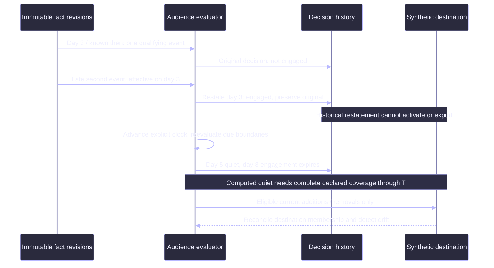
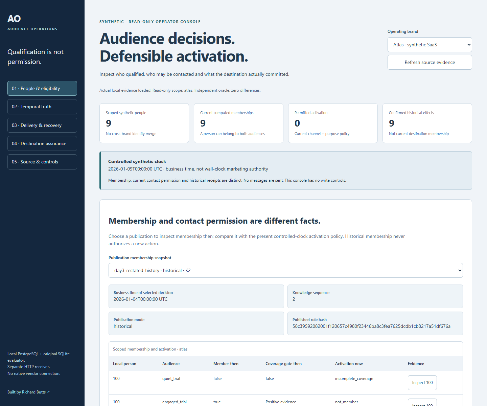

# Temporal Customer Audiences

**Who belongs in an audience now? How can late information correct yesterday without rewriting what we knew then?**

**Business impact:** Keep customer targeting accurate after late corrections, respect current eligibility and preserve the evidence behind historical decisions. This project maintains customer audiences across **business time** and **knowledge time**. It preserves original decisions, produces separate historical restatements, expires membership when no new data arrives, and emits only the changes needed by a synthetic destination.

**Business example:** A trial customer has one recorded product interaction on day 3 and does not qualify as engaged. A second interaction arrives later but belongs to that same day. The system can now show *both* the original decision based on what was known then and the corrected historical decision without rewriting history or sending an outdated audience change.

**Why it matters:** Audiences must also change when time passes, even if no new event arrives. This implementation reevaluates expiry dates, removes ineligible membership and reconciles changes with a synthetic destination. Importantly, it will not export a customer merely because no recent activity was observed: the source must provide complete coverage of the relevant quiet period. Audience qualification does **not** grant marketing consent. [See the executed timeline and counterexample](docs/evidence/report.md).



**Start with the [executed proof](docs/evidence/report.md).** One fictional trial customer makes the distinction visible:

| Question | Business time | Knowledge available | Result |
|---|---|---|---|
| What did we originally know? | Day 3 | One observed qualifying event | Not engaged |
| What does a late event change? | Same day 3 | Two qualifying events now known | Historical engagement changes; original decision remains intact |
| What happens with no new input? | Day 5 | Same knowledge | Quiet-trial membership begins as recent activity ages out |
| What happens later? | Day 8 | Same knowledge | Engaged-trial membership expires |

“Engaged” uses a seven-day window; “quiet” uses three days with no **observed** qualifying activity. The audiences can overlap. Neither is permission to contact a customer, and quiet does not prove no real-world activity occurred.

**Computed quiet is separate from export eligibility.** Without an explicit coverage assertion for the entire three-day observation window through T, quiet members are suppressed from the synthetic destination. At the first second beyond coverage, export eligibility expires even with no new customer facts. Engagement remains eligible on positive evidence. The [executed coverage counterexample](docs/evidence/report.md#executed-coverage-counterexample) shows this distinction without claiming real-source completeness.

## Temporal architecture boundary

This engine implements **retraction-aware audience history at two time coordinates and incremental reevaluation driven by both new facts and clock boundaries**. It maintains original and restated answers without claiming that audience eligibility itself grants marketing permission. Identity resolution, consent policy, approval and external workflow execution remain distinct governed responsibilities.

## What is demonstrated

- **Two-time correctness:** a late arrival changes a restated historical answer while the original knowledge-bounded answer stays reproducible.
- **Expiry without ingestion:** publishing at a later supplied clock processes due activity windows and future profile transitions.
- **Revision semantics:** retractions, late lower revisions and corrections that move effective time do not accidentally revive superseded facts.
- **Coverage-conditioned export:** missing, incomplete, expired or retracted coverage suppresses quiet activation; late coverage can restate historical eligibility without rewriting old generations. Clock-only expiry removes destination membership while reusing customer features.
- **Selective maintenance:** an executed one-person correction reevaluates **1 of 120 people**, with the same result as independent full evaluation. Full generation assembly still copies all people; this is not an end-to-end complexity or throughput claim.
- **Inspectable decisions:** additions/removals carry reasons; every generation retains source fact revisions, counts, evaluation coordinates and due boundaries. Coverage evidence and its evaluation coordinates are retained separately from reused customer decisions. A general before/after causal explanation is not implemented.
- **Historical/current separation:** a backfill cannot move the active pointer or produce an export bundle.
- **Destination correctness:** ordered deltas reconstruct the audience; old delivery cannot resurrect removed membership, and injected destination drift is detected.

## Audience Operations and Activation Assurance

An additive PostgreSQL operating layer now journals brand-scoped source batches and immutable publications, applies the original SQLite evaluator in a disposable per-brand cache, and separates membership from current channel/purpose permission. Reviewed additions and audited protective removals use a durable outbox; an independent local HTTP receiver persists ordered effects, receipts and separately queried business records in its own PostgreSQL database.

The new read-only console inspects current eligibility, original/restated history, source coverage, bounded delivery exceptions and independent destination reconciliation. All records are synthetic. This is a local finite contract, not a native marketing-platform connector or production guarantee. [Architecture and execution boundaries](docs/activation-assurance.md).



[Executed scenario, independent oracle and browser evidence](docs/evidence/activation-assurance/README.md).

### Run the operating demonstration

With Docker Compose installed:

```bash
docker compose up --build
```

Open **[Audience Operations](http://127.0.0.1:8596/)**. Select Atlas or Nova, inspect a person, compare the original and restated day-3 publications, and read a historical receipt from the separate receiver. The console is read-only; the finite synthetic acceptance harness performs the controlled writes before it starts. No cloud credentials or marketing messages are involved.

```bash
docker compose exec -T console python -m audience_ops.verify --config /console/console.json
docker compose down
```

Ordinary restarts preserve the journal and return the recorded acceptance result. `docker compose down --volumes` explicitly destroys only this Compose project's disposable demonstration data and generated credentials. A code/schema change requires a fresh environment rather than silently migrating recorded evidence. [Local PostgreSQL fallback, full verification and SQL views](docs/activation-assurance.md#reproduce-and-inspect).

## Reproduce

Use Python **3.12** from the extracted repository root:

```bash
python -m venv .venv
# Activate .venv for your shell.
python -m pip install -r requirements.lock
python -m pip install --no-deps --no-build-isolation -e .
python scripts/verify.py
```

The original temporal engine uses Python and SQLite, with no third-party runtime dependencies. Locked packages support testing and packaging. This original-engine command requires no cloud credentials, paid provider or Docker engine. The additive operating demonstration uses PostgreSQL and its separately locked dependencies.

Verification runs lint, dependency checks, temporal/boundary/negative tests, randomized incremental-versus-full checks and the complete asserted demonstration. Fresh results are written to `work/original-verification/`; the original [test results](docs/evidence/tests.xml), [source-hashed validation](docs/evidence/verification.json), [detailed proof](docs/evidence/temporal-proof.json) and [timeline CSV](docs/evidence/timeline.csv) remain archived unchanged. To run only the story: `python scripts/demo.py`.

## Boundaries

Customer records and destination behavior are synthetic. Person identity and normalized profile authority are assumed inputs. The original destination is a SQLite simulation; the additive operating receiver uses real local HTTP and a separate PostgreSQL database. Neither is a live vendor connector.

The executed build is local Windows/Python/SQLite. [Hosted temporal-history and incremental-equivalence verification passed on Windows and Ubuntu](https://github.com/rlbsem/temporal-customer-audiences/actions/runs/35055453097). This is separate from the local proof.

The rules are deliberately finite and person-local, with one source-wide coverage gate. The engine has an explicit clock and persisted due boundaries, not an always-on scheduler. Coverage is supplied synthetic evidence; the engine cannot establish whether a real source delivered everything. It does not establish privacy-erasure compliance, distributed scale or production readiness. [Architecture](docs/architecture.md), [operations](docs/operations.md) and [validation/limits](docs/validation.md) make those assumptions inspectable.

[Finished handoff](docs/handoff.md) · [Why this fifth project](docs/decision.md)
