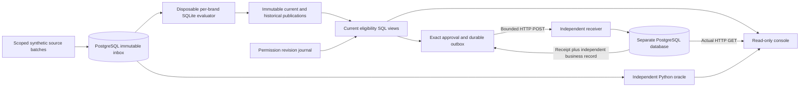

# Audience operations and activation assurance

The original SQLite engine remains the temporal evaluator. PostgreSQL is an additive operating journal, not a silent replacement of its two-time contract. Every brand has a separate disposable evaluator cache because source coverage is source-wide. Accepted PG batches are authoritative for replay; the cache can be discarded. There is no distributed SQLite/PostgreSQL transaction or selective-maintenance performance claim for this bridge.

## Current policy versus historical truth

Original and restated publications preserve business time, knowledge sequence, rule hash, implementation fingerprint and exact source evidence. Historical publication never moves the active pointer or creates an effect. Current activation additionally requires a fresh publication at the controlled current business clock, latest source knowledge, coverage for absence-based membership, and an unwithdrawn, unsuppressed, unexpired email permission for `trial_help`.

IDs are `(brand, local person)`. Shared local ID `100` does not imply a shared global identity. Profile and activity inputs are assumed normalized upstream; approved source identities are scoped by brand and source stream. No email/phone matching or native vendor source authority is inferred.

The clock is explicitly controlled for synthetic acceptance. It is not a production clock service, scheduler or claim of legal consent validity. New source knowledge or stale publication blocks new additions until reevaluation. Additions require an exact payload approval from a separate approver capability. Protective removals use an explicit audited controller policy and are not prospect communications.

## Delivery contract

A frozen effect carries brand, person, audience, channel, purpose, authority fingerprint and monotone per-key sequence. The receiver atomically persists an immutable receipt, separate business record and ordered membership state. Repeated exact effects return the historical receipt without applying the membership again. Older sequences cannot resurrect membership after removal. This is a finite local contract, not a claim about third-party APIs or universal exactly-once delivery.

A row lease fences workers. At most three POST budget reservations are durably committed before network I/O; reservations can exceed actual HTTP requests if a worker dies before sending. Present authority is rechecked after the reservation and serialized through the bounded HTTP call. This is not a distributed atomic transaction with permission withdrawal at the receiver.

Unknown readback is never treated as absence. Every uncertain retry first queries the receipt and separately stored business record. Historical recovery occurs before authorization for a new request. The third uncertain POST may still be reconciled, but cannot grant a fourth POST. Unknown or inconsistent readback exhausts a separate bounded check budget and remains an exception.

## Isolation and scope

Operating and receiver databases have different logins and no cross-database CONNECT grant. The console has a SELECT-only operating login and read-only receiver token. Its HTTP surface has no write routes. Scoped application capabilities are not production SSO, database tenant RLS or protection from a compromised trusted host administrator. The acceptance harness alone can inject synthetic receiver faults using its private receiver configuration; those fault controls are not HTTP endpoints or operator-console actions.

Runtime credentials are generated into private ignored working directories. They are not source evidence or public artifacts. Logs, connection strings and tokens must stay private.

The two databases share a PostgreSQL server in this demonstration. Separate storage and logins establish a reconciliation boundary, not independent hardware availability or disaster recovery. The receiver supports only two declared audiences, email and `trial_help`; permissions for another channel or purpose never authorize these effects.



SQL models are declared in [operating.sql](../src/audience_ops/operating.sql): `current_audience`, `activation_eligibility`, `permission_withdrawals`, `coverage_exceptions`, `historical_decisions`, `delivery_exceptions`, `source_fact_versions`, `destination_sync` and `reconciliation_findings`. `synchronization_status` counts historical outbox states, while `destination_sync` compares current authorization against the latest independently observed destination state. Neither silently treats an unobserved destination as synchronized. Plain governed SQL views fit this small operational model; an additional dbt execution layer would not improve its transaction or authorization boundary.

## Reproduce and inspect

The preferred Compose entry point and read-only verification command are in the [README](../README.md#run-the-operating-demonstration). Only the console is published, on loopback port 8596. PostgreSQL and receiver stay on the internal network. Separate private volumes carry the generated controller, receiver and console credentials. Application containers run without root or Linux capabilities and with read-only filesystems. The finite setup containers create only their own disposable demonstration state.

For an installed local PostgreSQL distribution, use Python 3.12 and a fresh working directory:

```bash
python -m pip install -r requirements-operations.lock
python -m pip install --no-deps --no-build-isolation -e .
python -m playwright install chromium
# Set PG_BIN to the directory containing initdb and pg_ctl, if not on PATH.
python -m audience_ops.demo --workspace work/local-console-01 --serve
```

Stop with Ctrl+C. The owned local runner shuts down its receiver, console and PostgreSQL server, removing only its registered databases and logins. Private configuration and PostgreSQL logs under ignored `work/` must never be published. `OPS_TEST_ADMIN_DSN` is an alternative for a disposable localhost CI PostgreSQL service; do not point it at a shared or production database. It needs database/role creation rights solely to establish and remove the isolated test identities.

Full regression, independent reconciliation and genuine browser capture:

```bash
python scripts/verify_operations.py --workspace work/acceptance-01 --output work/evidence-01
```

Both paths must be new. This command runs the original suite, adversarial operating tests, the complete original proof, the 36-check PostgreSQL/HTTP scenario, an independent source-based oracle, and the real console in Chromium. It captures desktop/mobile screenshots and WCAG A/AA checks with pinned axe-core. It never overwrites historical evidence. Automated accessibility checks supplement manual screenshot inspection; they do not establish universal accessibility.

The independent oracle reconstructs latest fact revisions before filtering business time, evaluates left-exclusive windows and coverage assertions, and compares every published decision and current permission result. It does not call the original evaluator or accept its aggregate counts as proof. The wrong-grain regression deliberately exposes multiplicative joins while checking the proper scoped-person/audience grain.

## Execution status

The original 58 SQLite regressions, 40 operating/contract regressions and 36 end-to-end PostgreSQL/HTTP scenario assertions have executed in the Linux CI lane. The scenario includes real process termination, lost acknowledgment, permission withdrawal/expiry, coverage expiry, historical correction and receiver drift. The 36 scenario assertions also run inside one regression test; these counts are different kinds of checks and should not be summed as independent test cases. Windows and Linux retain the original 58-test lane.

The operating oracle compares 164 historical person/audience decisions across ten publications and 20 current eligibility rows, with zero differences. Chromium exercises 50 brand/view/viewport states, 109 interaction/layout assertions and 20 automated accessibility scans. Source, screenshot and execution fingerprints accompany the fresh recorded evidence. Container results and the final local capture are reported separately; an unexecuted lane is never described as passing.

The [preservation inventory](evidence/activation-assurance/original-files.json) binds the original engine, tests and archived evidence to main `01f3a18`. Fresh original-engine verification now writes under `work/`, never over the historical records.
